# Multiplayer Ludo — ERD

**Status:** hardened design baseline (2026-11-01)  
**Repository:** https://github.com/ViswjeetKumar/ludo-gaming-app  
**Authoritative state model:** `GAME_EVENTS` is the durable, append-only source of game truth. `GAMES.state_snapshot` is a derived, versioned recovery cache that may be rebuilt by replaying events. No table stores a second authoritative piece-position state.

PostgreSQL is the durable source of truth. Redis is only for short-lived presence, rate-limit counters, game-command coordination and fan-out; no accepted command, secret, event or fairness evidence may exist only in Redis.

```mermaid
erDiagram
  USERS ||--o{ AUTH_IDENTITIES : links
  USERS ||--o{ REFRESH_SESSIONS : owns
  USERS ||--o| PLAYER_PROFILES : has
  USERS ||--o{ EMAIL_VERIFICATION_TOKENS : verifies
  USERS ||--o{ PASSWORD_RESET_TOKENS : resets
  USERS ||--o{ USER_ROLES : receives
  USERS ||--o{ GAME_ROOMS : hosts
  USERS ||--o{ ROOM_MEMBERS : joins
  USERS ||--o{ GAME_SEATS : occupies
  USERS ||--o{ GAME_INVITES : sends_or_receives
  USERS ||--o{ FRIENDSHIPS : participates
  USERS ||--o{ COMMAND_LOG : sends
  USERS ||--o{ REPORTS : files_or_is_target
  USERS ||--o{ MODERATION_ACTIONS : acts_or_is_target
  USERS ||--o{ AUDIT_LOG : acts
  GAME_ROOMS ||--o{ ROOM_MEMBERS : contains
  GAME_ROOMS ||--o{ GAME_INVITES : issues
  GAME_ROOMS ||--o{ GAMES : hosts_rematches
  GAMES ||--|{ GAME_SEATS : freezes
  GAMES ||--o{ GAME_TURNS : records
  GAMES ||--o{ DICE_ROLLS : records
  GAMES ||--o{ GAME_EVENTS : appends
  GAMES ||--|| GAME_SECRETS : protects_seed
  GAMES ||--|| FAIRNESS_PROOFS : verifies
  GAMES ||--o{ COMMAND_LOG : deduplicates
  GAMES ||--o{ OUTBOX_EVENTS : publishes
  GAMES ||--o{ REPORTS : is_reported
  GAMES ||--o{ MODERATION_ACTIONS : is_moderated
  GAME_SEATS ||--o{ GAME_TURNS : takes
  GAME_TURNS ||--o{ DICE_ROLLS : contains
  GAME_TURNS ||--o{ COMMAND_LOG : resolves
  USERS ||--o{ AUDIT_LOG : is_target

  USERS {
    uuid id PK
    citext username UK
    citext email UK
    text password_hash
    text status
    timestamptz created_at
    timestamptz deleted_at
  }
  AUTH_IDENTITIES {
    uuid id PK
    uuid user_id FK
    text provider
    text provider_subject
    timestamptz created_at
  }
  REFRESH_SESSIONS {
    uuid id PK
    uuid user_id FK
    text token_hash UK
    timestamptz expires_at
    timestamptz revoked_at
  }
  PLAYER_PROFILES {
    uuid user_id PK,FK
    text display_name
    text avatar_key
    jsonb preferences
    timestamptz updated_at
  }
  EMAIL_VERIFICATION_TOKENS {
    uuid id PK
    uuid user_id FK
    text token_hash UK
    timestamptz expires_at
    timestamptz used_at
  }
  PASSWORD_RESET_TOKENS {
    uuid id PK
    uuid user_id FK
    text token_hash UK
    timestamptz expires_at
    timestamptz used_at
  }
  USER_ROLES {
    uuid id PK
    uuid user_id FK
    text role
    uuid granted_by FK
    timestamptz granted_at
    timestamptz revoked_at
  }
  GAME_ROOMS {
    uuid id PK
    uuid host_user_id FK
    text join_code_hash
    text visibility
    text status
    smallint capacity
    jsonb proposed_rules
    timestamptz expires_at
    timestamptz created_at
  }
  ROOM_MEMBERS {
    uuid room_id PK,FK
    uuid user_id PK,FK
    text status
    timestamptz joined_at
    timestamptz left_at
  }
  GAME_INVITES {
    uuid id PK
    uuid room_id FK
    uuid sender_user_id FK
    uuid recipient_user_id FK
    text token_hash
    text status
    timestamptz expires_at
    timestamptz used_at
  }
  GAMES {
    uuid id PK
    uuid room_id FK
    text status
    text rules_version
    jsonb rules_snapshot
    bigint version
    smallint active_seat_index
    timestamptz turn_deadline_at
    jsonb state_snapshot
    bigint snapshot_sequence
    text finished_reason
    timestamptz started_at
    timestamptz finished_at
  }
  GAME_SEATS {
    uuid id PK
    uuid game_id FK
    uuid user_id FK
    smallint seat_index
    text color
    text status
    integer timeout_streak
    timestamptz joined_at
    timestamptz forfeited_at
  }
  GAME_TURNS {
    uuid id PK
    uuid game_id FK
    uuid seat_id FK
    integer turn_number
    text status
    text action_type
    jsonb action_payload
    bigint version_before
    timestamptz completed_at
  }
  DICE_ROLLS {
    uuid id PK
    uuid game_id FK
    uuid turn_id FK
    uuid seat_id FK
    integer roll_index
    smallint outcome
    bytea proof_digest
    timestamptz created_at
  }
  GAME_EVENTS {
    uuid id PK
    uuid game_id FK
    bigint sequence_number
    text event_type
    jsonb public_payload
    bytea previous_hash
    bytea event_hash
    timestamptz created_at
  }
  GAME_SECRETS {
    uuid game_id PK,FK
    bytea encrypted_seed
    bytea encrypted_data_key
    text kms_key_id
    timestamptz created_at
    timestamptz destroyed_at
  }
  FAIRNESS_PROOFS {
    uuid game_id PK,FK
    bytea server_seed_commitment
    bytea revealed_server_seed
    jsonb player_nonce_commitments
    jsonb revealed_player_nonces
    bytea final_seed_commitment
    text algorithm_version
    text verification_status
    timestamptz revealed_at
    timestamptz verified_at
  }
  COMMAND_LOG {
    uuid id PK
    uuid game_id FK
    uuid user_id FK
    text idempotency_key
    text command_type
    bytea response_hash
    uuid turn_id FK
    timestamptz created_at
    timestamptz expires_at
  }
  OUTBOX_EVENTS {
    uuid id PK
    uuid aggregate_id FK
    text event_type
    jsonb payload
    timestamptz created_at
    timestamptz delivered_at
    integer attempts
  }
  FRIENDSHIPS {
    uuid id PK
    uuid requester_id FK
    uuid addressee_id FK
    text status
    timestamptz updated_at
  }
  REPORTS {
    uuid id PK
    uuid reporter_id FK
    uuid target_user_id FK
    uuid game_id FK
    text reason_code
    text details
    text status
    uuid resolved_by FK
    timestamptz created_at
    timestamptz resolved_at
  }
  MODERATION_ACTIONS {
    uuid id PK
    uuid moderator_user_id FK
    uuid target_user_id FK
    uuid game_id FK
    text action
    text reason_code
    timestamptz expires_at
    timestamptz created_at
  }
  AUDIT_LOG {
    uuid id PK
    uuid actor_user_id FK
    uuid target_user_id FK
    text action
    text target_type
    uuid target_id
    text reason
    text request_id
    timestamptz created_at
  }
```

## Integrity, concurrency and fairness constraints

- v1 seats are human authenticated accounts only: `GAME_SEATS.user_id` is non-null; bots and guests are out of scope **[CONFIRM]**. A room may host multiple completed games for rematches; each rematch creates a new `GAMES` row with a new proof **[CONFIRM]**.
- A game start copies `GAME_ROOMS.proposed_rules` into immutable `GAMES.rules_snapshot` and records `rules_version`. Room rules cannot change after a game starts.
- Enforce unique `(game_id, user_id)`, `(game_id, seat_index)`, and `(game_id, color)` on seats; `capacity BETWEEN 2 AND 4`; valid seat/color/status enums; `timeout_streak >= 0`.
- `GAME_EVENTS` has unique `(game_id, sequence_number)`. In one transaction, lock/serialize the game, append the next canonical event, calculate `event_hash = SHA-256(previous_hash || canonical_event)`, advance `GAMES.version`, rebuild/write the derived snapshot, and enqueue an `OUTBOX_EVENTS` row. A verifier recomputes the full chain from the fixed genesis hash and rejects sequence gaps, duplicate sequences, altered payloads, or hash mismatches.
- `GAMES.state_snapshot` and `snapshot_sequence` are a derived cache only; a recovery job replays events to rebuild it. `GAME_SEATS` deliberately has no `pieces` column.
- `COMMAND_LOG` has unique `(game_id, user_id, idempotency_key)`, stores command type and response hash, and retains entries through the retry window. Both `game.roll` and `game.move` first read/write this row within the same serialized transaction; a retry returns the original response and never reruns the command.
- `DICE_ROLLS.outcome CHECK (outcome BETWEEN 1 AND 6)`; unique `(game_id, roll_index)`; a roll must reference a turn and the turn's seat. `GAME_TURNS` is ordered with unique `(game_id, turn_number)`.
- `GAME_SECRETS` contains the only live server seed. It is envelope-encrypted with a per-game data key; `encrypted_data_key` is wrapped by the named KMS key. Only the roll/fairness service DB role may read it. API, support, analytics, read-only and migration roles cannot. Every read is audit logged; the seed must never enter snapshots, events, logs, metrics, crash dumps, caches, Redis, analytics exports, backups in plaintext, or client responses.
- At match finish/void, the fairness service writes the disclosed server seed and entropy data to `FAIRNESS_PROOFS`, destroys the `GAME_SECRETS` row/material, and sets `destroyed_at`. The seed compromise response is documented in `docs/RUNBOOKS.md`.
- The pre-game protocol is: server publishes SHA-256(server_seed); every seat commits SHA-256(client_nonce); every seat reveals its nonce; service verifies commitments and derives final_seed with the versioned binary encoding in `docs/FAIRNESS_VECTORS.md`; then game starts. Invalid/missing reveal before first roll cancels the start and returns the room to lobby with no penalty. Proof data is retained for independent verification.
- `OUTBOX_EVENTS` is written in the same database transaction as state/event changes. A dispatcher may retry delivery; consumers deduplicate by its id. `attempts >= 0`.

## Indexes, foreign keys and retention

- Index active room lookup by `(status, expires_at)`, members by `(user_id, room_id)`, invite expiry by `(status, expires_at)`, games by `(room_id, started_at DESC)` and `(status, turn_deadline_at)`, events by `(game_id, sequence_number)`, command expiry by `(expires_at)`, outbox by `(delivered_at, created_at)`, reports by `(status, created_at)`, and audit log by `(target_type, target_id, created_at)`.
- Match-integrity tables (`GAMES`, `GAME_SEATS`, `GAME_TURNS`, `DICE_ROLLS`, `GAME_EVENTS`, `GAME_SECRETS`, `FAIRNESS_PROOFS`, `COMMAND_LOG`, `OUTBOX_EVENTS`) use `ON DELETE RESTRICT` from users/rooms and are never cascade-deleted. Account deletion pseudonymizes permitted personal references after the retention policy rather than deleting the match record.
- Ephemeral token/invite/session rows may use restricted cascading only from a deleted/pseudonymized account after expiry; completed integrity data, reports and audit records stay protected. Retention periods and deletion jobs are specified in the development spec and live-security document.
- `AUDIT_LOG` is append-only. Application DB roles have no update/delete grant; it rejects secret-bearing action payloads and stores only identifiers, reason codes and request IDs.

## Per-table data classification

| Table | Classification | Notes |
|---|---|---|
| USERS, AUTH_IDENTITIES, REFRESH_SESSIONS, PLAYER_PROFILES | personal | Authentication/profile data; hashes do not make it public. |
| EMAIL_VERIFICATION_TOKENS, PASSWORD_RESET_TOKENS | secret | Hashed token only; never log raw token. |
| USER_ROLES, AUDIT_LOG, MODERATION_ACTIONS | internal | Privileged/security record; audit is append-only. |
| GAME_ROOMS, ROOM_MEMBERS, GAME_INVITES, FRIENDSHIPS | personal | Membership and social graph; invite token hash is secret. |
| GAMES, GAME_SEATS, GAME_TURNS, DICE_ROLLS, GAME_EVENTS, OUTBOX_EVENTS, COMMAND_LOG | internal | Sanitized selected game history can be shared with its participants. |
| GAME_SECRETS | secret | Encrypted seed and data-key envelope; most restrictive DB role. |
| FAIRNESS_PROOFS | internal | Disclosed proof is participant-visible after terminal state; no account identifiers or private chat. |
| REPORTS | personal | Restricted moderator access and retention. |
