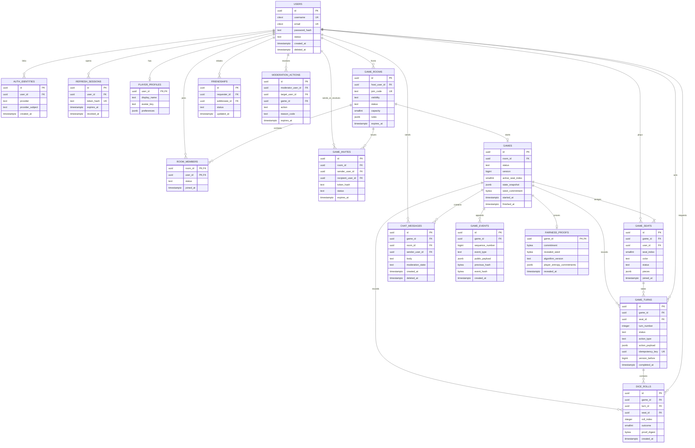

# Multiplayer Ludo — ERD

**Status:** design baseline (2026-11-01)  
**Repository:** https://github.com/ViswjeetKumar/ludo-gaming-app

PostgreSQL is the durable source of truth. Redis may coordinate presence, matchmaking and rate limits, but no accepted move or fairness evidence may exist only in Redis.

## Constraints and integrity

- `AUTH_IDENTITIES`: unique(provider, provider_subject). `REFRESH_SESSIONS` stores only a hash of a high-entropy opaque token; rotate on use and revoke by session.
- Rooms support 2–4 seats. A started match freezes its participants, seat indices, colors and rules. Unique(game_id,user_id), (game_id,seat_index), and (game_id,color) constraints prevent duplicate seats.
- A game version increases on every accepted state transition. A command names its expected version and an idempotency key. Apply it in one transaction with row locking or compare-and-swap; stale/replayed requests cannot move a piece or roll again.
- Turns are ordered and scoped to the active seat. Dice outcomes are server-generated and constrained 1..6. Store roll proof and the turn/action that consumed it.
- `GAME_EVENTS` is append-only and sequence-numbered. Hash each canonical event with the previous hash to reveal deletion or reorder attempts; keep personal data out of public payloads.
- Publish `seed_commitment = SHA-256(server_seed)` before the first roll. After match end or void, reveal the seed and algorithm version so clients can independently recompute every roll. Never expose the seed while play is active.
- An invite stores only a hash of its random bearer token, is single-use, scoped to a room and expires. Friendship pair uniqueness uses a canonical pair check.
- Chat has exactly one scope (room or game). Moderation actions and fairness records are retained as append-only audit facts. Account deletion must not cascade-delete completed matches or proofs.
- Enforce foreign keys, check constraints, indexes on active games/rooms, participant lookups, event sequence, expiry and moderation queues. Define explicit retention/deletion rules for personal data.
